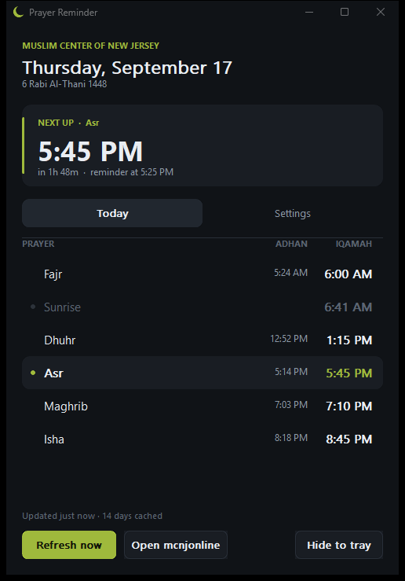
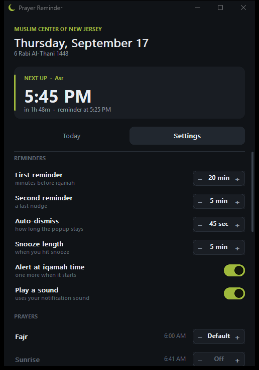

# Prayer Reminder

A small Windows tray app that pulls the iqamah times your masjid publishes
and pops up a reminder before each congregation, so you know when to leave.

Native C + Win32. No runtime, no installer, no dependencies beyond the
Windows system DLLs. One ~270 KB `.exe`.

It ships pointed at the [Muslim Center of New Jersey](https://mcnjonline.com/),
which is my masjid, but any masjid whose website uses a
[Masjidal](https://masjidal.com/) prayer-times widget works with a three-line
config change. See [Use it for your own masjid](#use-it-for-your-own-masjid).



## What it does

- Fetches **14 days** of adhan and iqamah times and caches them, so it keeps
  working offline and across midnight without a network round trip.
- Reminds you at up to **three moments** per prayer: two configurable lead
  times (default 20 and 5 minutes before iqamah) and optionally at iqamah
  itself.
- Handles **Friday** properly: Dhuhr is replaced by the Jumu'ah you attend.
- Lives in the tray. The tooltip always reads `Asr 5:45 PM — in 1h 12m`,
  and the menu can pause reminders for an hour, four hours, or until tomorrow.
- The popup has **Snooze** and **Dismiss**, auto-dismisses after a
  configurable delay, and clicking it opens the app.


## Use it for your own masjid

Open **Settings → Masjid → Edit config.ini** (or edit
`%APPDATA%\PrayerReminder\config.ini` directly) and change the `[masjid]`
section:

```ini
[masjid]
name=Masjid Al-Noor
website=https://www.masjidalnoor.example/
masjidalId=AbCdEfGh
accent=2E7D32
```

| Key | Meaning |
|---|---|
| `name` | Shown at the top of the window. |
| `website` | What "Open website" opens. Also used as the scraping fallback if the feed is down. |
| `masjidalId` | The `masjid_id` in your masjid's Masjidal feed. See below. |
| `accent` | Optional. Brand colour as `RRGGBB` hex; drives the highlights, buttons and the tray icon. |

Save the file and click back into the app. It notices the edit, reloads,
drops the old masjid's cache and fetches the new times. No restart needed.

**Finding your `masjidalId`.** Many masjid websites that show a live prayer
table embed Masjidal's widget. On your masjid's site, open *View page source*
and search for `masjidal`. The classic embed is an iframe whose URL looks
like `https://masjidal.com/widget/simple?masjid_id=XXXXXXXX`; the
eight-character id is what you want. (Masjidal's newer `<masjidal-widget>`
element carries a `widget-id` instead; if that is all you find, ask whoever
runs the site for the masjid id from Masjidal's *Settings → Web Integration*
tab.) You can confirm an id by opening

```
https://masjidal.com/api/v1/time/range?masjid_id=XXXXXXXX&from_date=2026-01-01&to_date=2026-01-03
```

in a browser: if you get JSON with `salah` and `iqamah` arrays, you're set.

If your masjid does not use Masjidal, the app can't read its times yet.
The fetch and parse code is isolated in one function (`fetch_thread` in
`src/times.c`), so adding another source is a contained change; PRs welcome.

**Rebranding the icon.** `tools/make_icon.py 2E7D32` regenerates
`src/app.ico` in your colour before you build. The tray icon is drawn at
runtime from `accent`, so it follows the config without a rebuild.

## Build

Needs MinGW-w64 (MSYS2 UCRT64 is what this was built with).

```sh
./build.sh          # or: build.bat
```

That produces `PrayerReminder.exe` in the project root. Building does not
require Python; `tools/make_icon.py` only matters if you want a different
icon colour baked into the `.exe` itself.

## Run

Just launch `PrayerReminder.exe`. It adds a tray icon and, by default,
registers itself to start with Windows (`--tray`, quietly in the background).
Closing the window hides it to the tray; **Exit** from the tray menu quits.

Settings are saved immediately to:

```
%APPDATA%\PrayerReminder\config.ini
%APPDATA%\PrayerReminder\cache-<masjidalId>.json     <- cached times
```

## Settings



| Setting | Meaning |
|---|---|
| **First / second reminder** | Minutes before iqamah. Set to `Off` to disable that one. |
| **Alert at iqamah time** | One more popup exactly when the iqamah starts. |
| **Auto-dismiss** | How long the popup stays. `Never` keeps it until you click it. |
| **Snooze length** | What the Snooze button gives you. |
| **Prayers** | Per prayer: `Off`, `Default` (use the global lead times), or a custom lead that replaces them. Fajr often deserves more warning than Maghrib. |
| **Friday** | Which congregation to be reminded of: Jumu'ah 1, Jumu'ah 2, both, or plain Dhuhr. |
| **Start with Windows / Start minimised** | Autostart, and whether the window shows on launch. |
| **Daily refresh** | Hour at which fresh times are pulled. It also self-heals hourly if that moment was missed (machine asleep). |
| **Time offset** | Shifts every time by ±60 minutes. |
| **Masjid** | Shows which masjid you're following, with buttons to edit `config.ini` and open the data folder. |

The stepper for lead times moves in 5-minute increments. If you want an
exact value like 7, edit `lead1Min` in `config.ini` directly; anything from
1 to 180 is accepted.

**Preview reminder** (bottom of Settings) shows the popup with your current
settings so you can tune it without waiting for a prayer.

## Where the times come from

The app reads the Masjidal feed directly
(`masjidal.com/api/v1/time/range?masjid_id=…`). That is the same data your
masjid's website shows, but structured, and it covers a date range rather
than only today. The raw JSON body is cached as-is, so the cache and the
live path share one parser. If the feed ever fails, the app falls back to
scraping the prayer table off the masjid's homepage, and refuses a partial
scrape rather than showing half a day.

Two things worth knowing:

- **Jumu'ah times are the khutbah start**, which is what you actually need to
  be there for. The feed does not carry a separate Jumu'ah iqamah.
- **Times are used as-is, in your PC's local timezone.** That is right as
  long as your machine is in the same zone as the masjid. If you travel, use
  *Time offset* rather than expecting a conversion.

## Layout

```
src/
  app.h        shared types and declarations
  main.c       entry point, tray icon, scheduler tick
  times.c      JSON + HTML parsing, caching, background fetch
  sched.c      turns a day's times into reminder events
  config.c     ini load/save, autostart registration, reload-on-edit
  net.c        WinHTTP GET
  gfx.c        drawing helpers (antialiased shapes, fonts, widgets)
  ui_main.c    main window
  ui_toast.c   the reminder popup
```

The popup is a per-pixel-alpha layered window, so its rounded corners are
genuinely antialiased over any wallpaper. Everything else is double-buffered
GDI; shapes that need smooth edges are drawn oversized and downsampled,
which keeps the binary free of GDI+.

A few decisions that matter more than they look:

- Reminders are scheduled for today **and tomorrow**, so a 4:30 AM Fajr
  alert is already queued before midnight.
- The one-second tick never fires a burst of stale alerts after the machine
  wakes from sleep; anything more than five minutes overdue is skipped.
- Every time is an integer of minutes from local midnight, and
  conversions go through `mktime` with `tm_isdst = -1`, so DST changes are
  resolved by the C runtime rather than by arithmetic.
- The fetch runs on its own thread and hands its result to the UI thread
  with `PostMessage`, so there is no shared mutable state to lock.

## License

MIT. See [LICENSE](LICENSE).
